<p align="center">
  
</p>

<p align="center">
  <strong>Клиенты, подписки и VPN-инфраструктура — в одной панели.</strong><br />
  Управление собственным сервером и узлами через веб-интерфейс и Telegram.
</p>

<p align="center">
  <a href="#установка">Установка</a> ·
  <a href="#возможности">Возможности</a> ·
  <a href="#интерфейс">Интерфейс</a> ·
  <a href="#документация">Документация</a> ·
  <a href="CHANGELOG.md">Изменения</a>
</p>

<p align="center">
  <a href="https://github.com/tro9n4ik/md-next/actions/workflows/ci.yml"></a>
  <a href="LICENSE"></a>
</p>

Текущая версия: **2.5.14** · FastAPI · React · TypeScript · Xray

## Возможности

| Задача | Что есть в панели |
| --- | --- |
| Выдать доступ | Подписка, QR-коды, личная страница и отдельные подключения |
| Управлять клиентами | Группы, онлайн-статус, сроки, продление и месячные лимиты |
| Выбрать страну | Общий или персональный маршрут, дополнительные страны в подписке |
| Управлять сетью | Узлы, резервирование, DNS, правила маршрутизации и WARP |
| Работать через Telegram | Создание и продление подписок, кабинет клиента и уведомления |
| Следить за сервером | Нагрузка, трафик, события, история доступности и диагностика |
| Администрировать | Права сотрудников, двухфакторная аутентификация и резервные копии |

**Подключения:** VLESS Reality, VLESS XHTTP, Hysteria 2, AmneziaWG, Telegram MTProto и «Обход БС».
AmneziaWG выдаётся отдельным файлом, Telegram — отдельной ссылкой. Совместимость зависит от VPN-приложения и его версии.

## Установка

Проверены **Ubuntu 22.04 / 24.04 и Debian 12, amd64**. Рекомендуется чистый VPS: **1 CPU, 2 ГБ RAM, 10 ГБ диска**.
Нужны права администратора, основной домен и поддомен панели с A-записями на сервер. Домены должны быть доступны для выпуска TLS-сертификатов.

```bash
curl -fsSL https://raw.githubusercontent.com/tro9n4ik/md-next/main/scripts/bootstrap.sh | sudo bash
```

В меню выберите установку. Скрипт запросит домены и почту для Let's Encrypt, настроит службы и покажет пароль администратора. Сохраните его и включите 2FA.

<details>
<summary>Установка из клонированного репозитория и совместимость</summary>

```bash
git clone https://github.com/tro9n4ik/md-next.git
cd md-next
sudo bash scripts/install.sh
```

Репозиторий публичный, авторизация GitHub для скачивания не нужна. Установщик выполняется с правами администратора: исходный скрипт можно скачать и просмотреть перед запуском. Для воспроизводимой установки закрепите проверенный коммит.

Для arm64 предусмотрены загрузки upstream, но полный цикл установки пока не проверен. Alpine не поддерживается: используются APT и systemd. Требования к ресурсам и трафику зависят от числа клиентов.

</details>

## Интерфейс

Настоящий интерфейс на вымышленных данных. Все демонстрационные скриншоты — **1920×1080**.

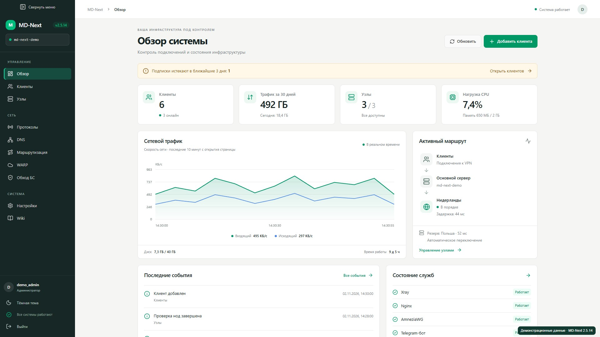

<details>
<summary>Клиенты, подключение, страны и управление подпиской</summary>

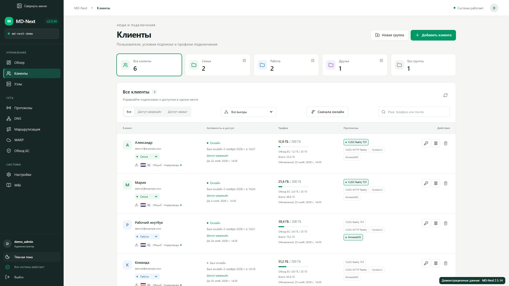

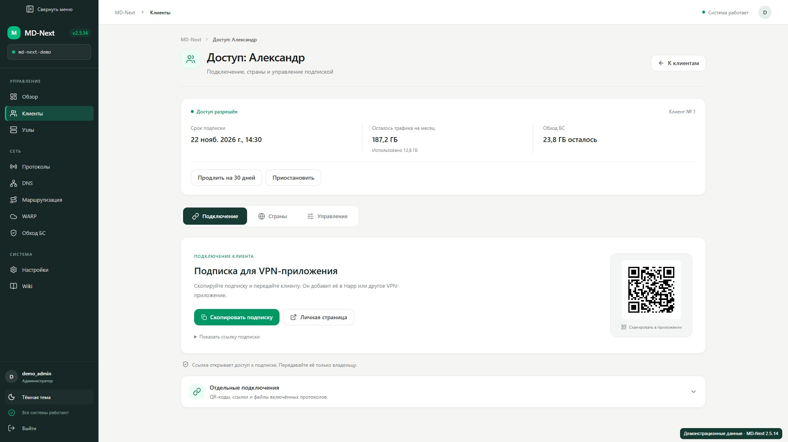

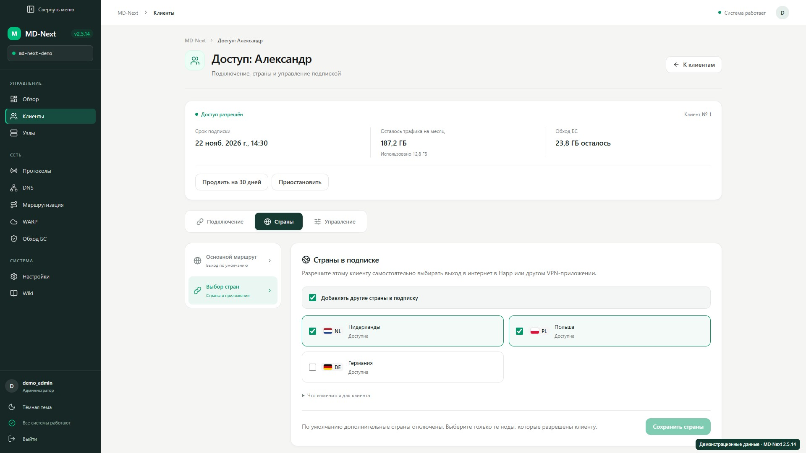

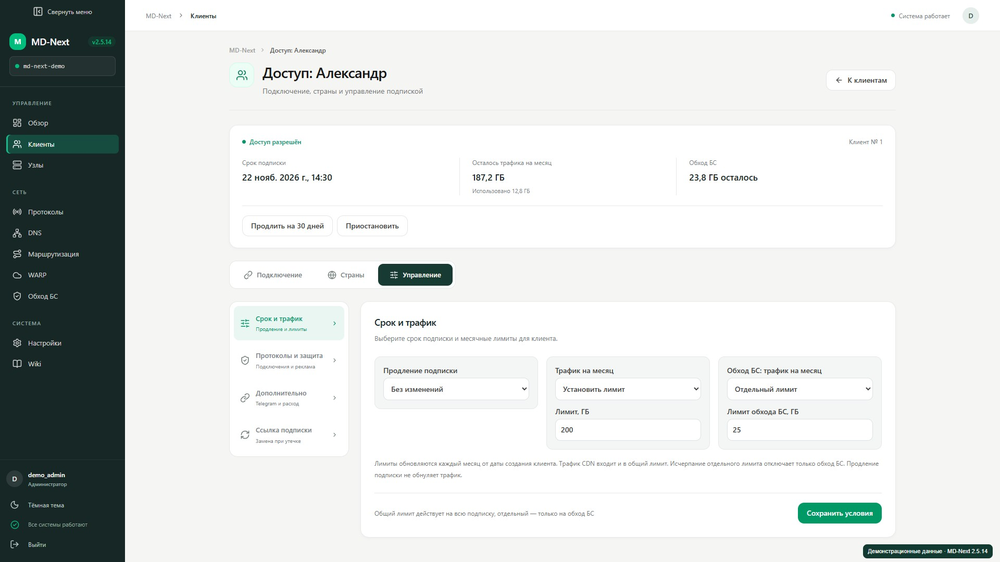

</details>

<details>
<summary>Узлы, настройки, Telegram и другие экраны</summary>

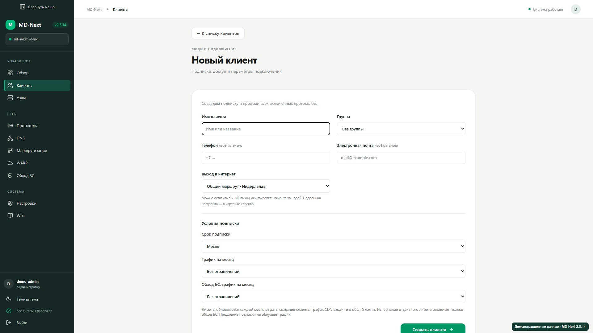

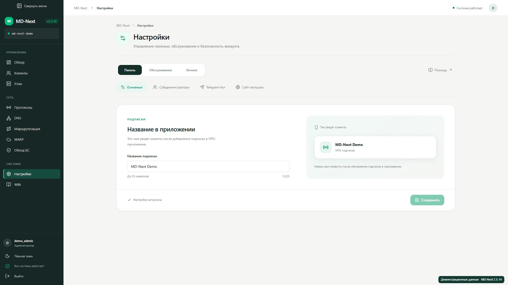

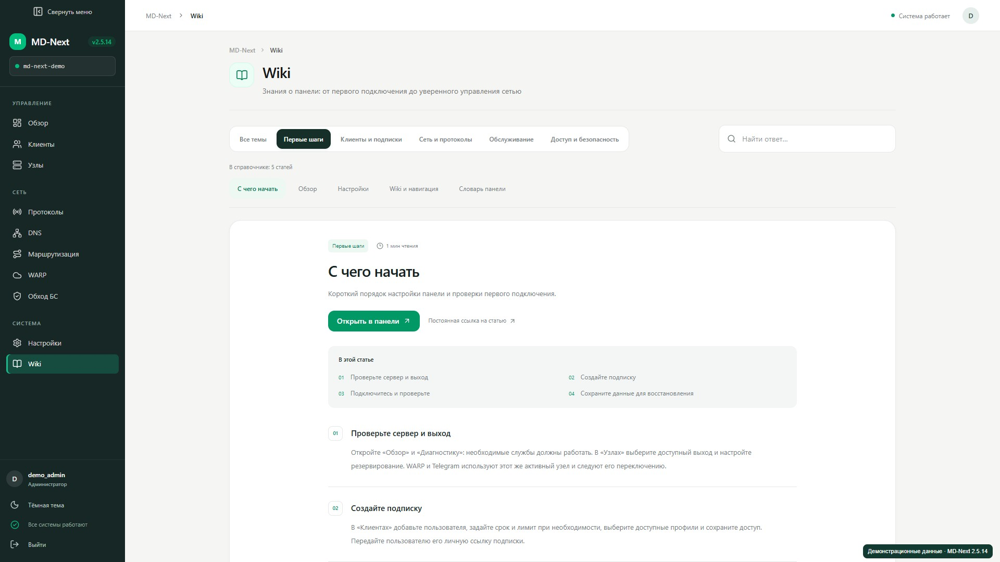


**Узлы:** текущий выход, резервирование и приоритеты.

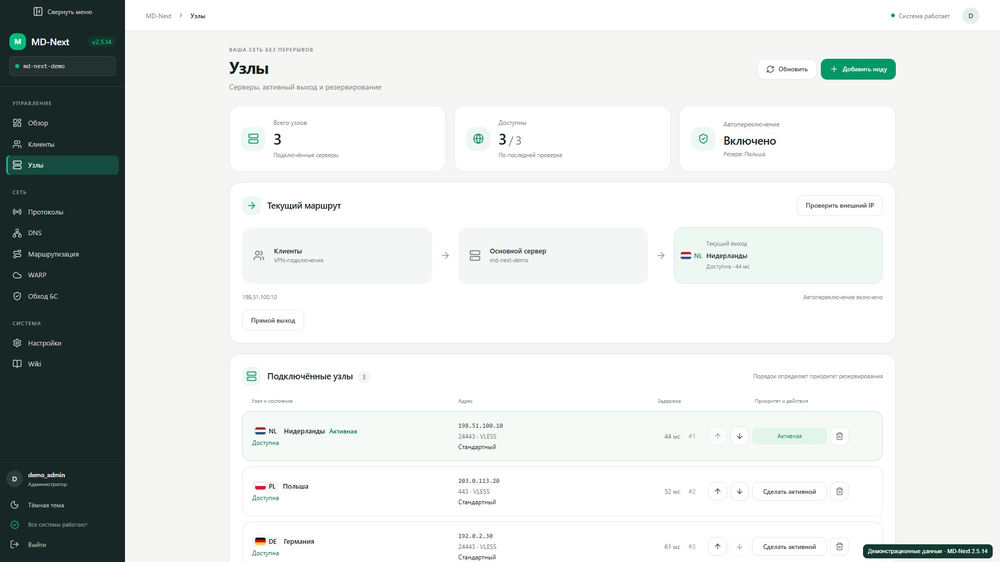

**WARP:** сервисы через отдельный выход и проверка региона Google для Gemini.

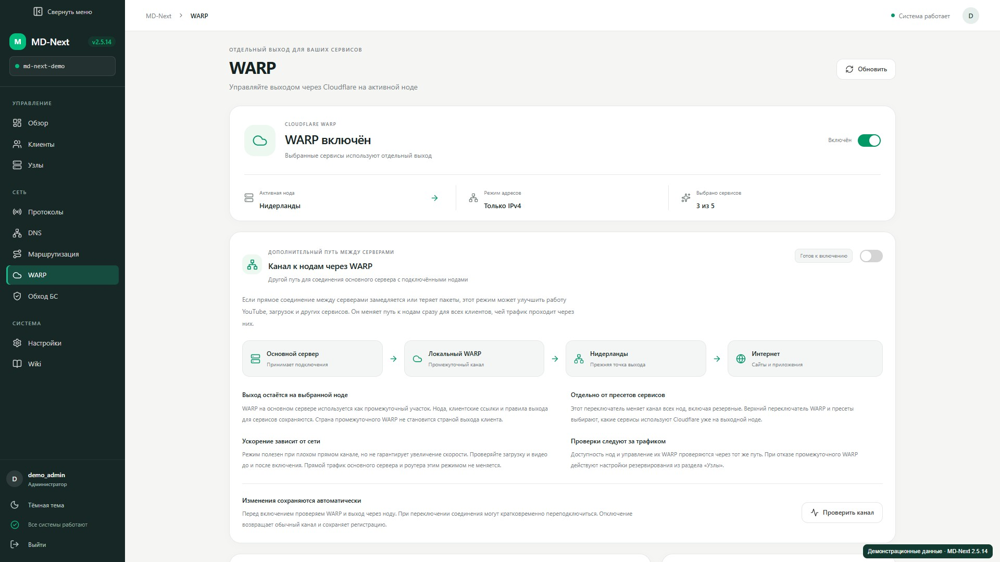

**Reality:** подбор SNI и target по базовым проверкам совместимости.

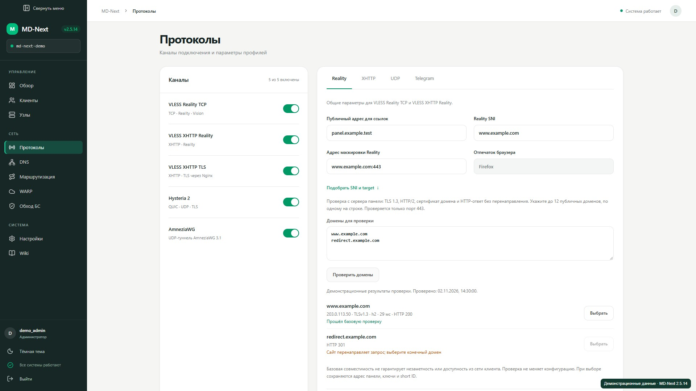

**Субадминистраторы:** отдельные права и выбор видимости клиентов.

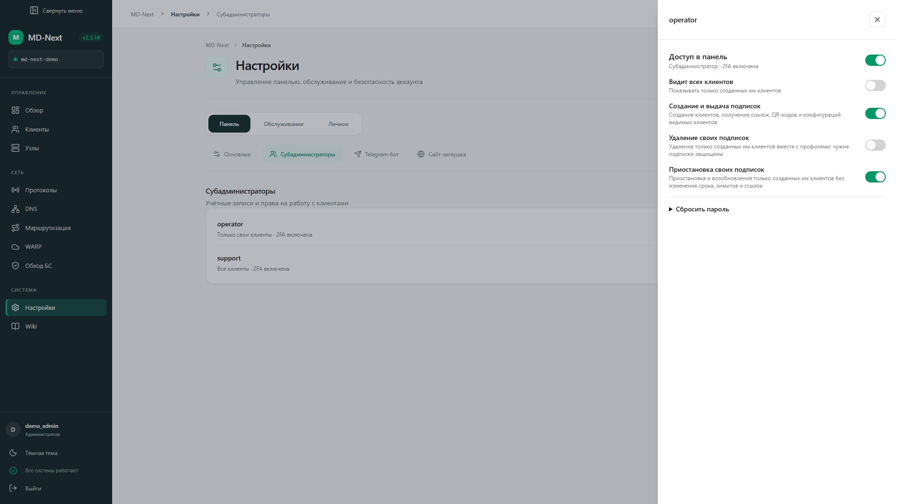

**Telegram:** настройки бота и предпросмотр меню.

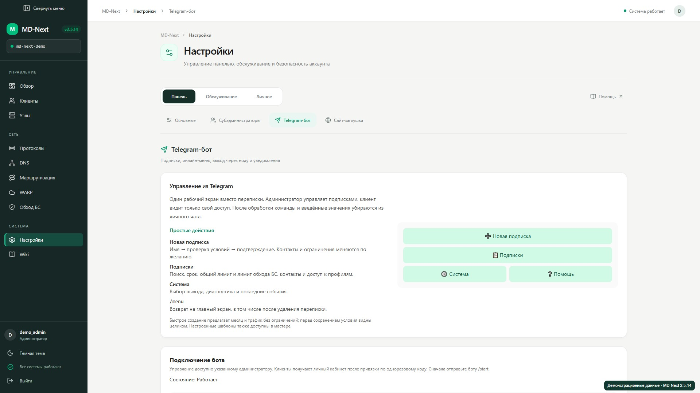

**Тёмная тема:** тот же интерфейс с сохранённой навигацией и функциями.

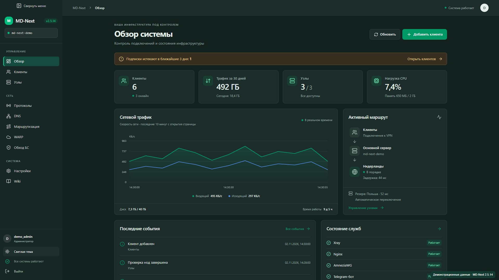

</details>

## Обновление

Откройте **Настройки → Обслуживание → Обновление панели**. Панель проверит сборку из `main`, создаст резервную копию и выполнит обновление. При ошибке применения предусмотрен автоматический откат.

[Как работает обновление](docs/panel-updates.md) · [Резервные копии](docs/administration.md#резервные-копии)

## Документация

| Для работы | Для настройки и разработки |
| --- | --- |
| [Администрирование и резервные копии](docs/administration.md) | [Локальная разработка](docs/development.md) |
| [Telegram-бот и кабинет клиента](docs/telegram-bot.md) | [Проверки и тесты](docs/testing.md) |
| [Личные страницы подписок](docs/subscription-pages.md) | [Защита входного сервера](docs/edge-security.md) |
| [Переезд на другой VPS](docs/vps-migration.md) | [Настройка CDN](docs/cdn-setup.md) |
| [История изменений](CHANGELOG.md) | [Сторонние компоненты и лицензии](docs/third-party-notices.md) |

Встроенная **Wiki** доступна из меню панели. [Как воспроизвести демонстрационные скриншоты](docs/demo-screenshots.md).

## Безопасность и границы проверки

Новые установки запускают backend от пользователя `md-next`; системные действия выполняет отдельный помощник с фиксированным набором команд. Используйте уникальный пароль, 2FA и храните внешнюю копию данных. Архивы резервных копий содержат секреты и приватные ключи.

Автоматические проверки не гарантируют работу всех протоколов во всех приложениях и сетях. [Состояние проверок](docs/release-readiness.md) · [Отчёт аудита](docs/public-security-audit.md) · [Сообщить об уязвимости](SECURITY.md).

---

[MIT](LICENSE) · [Лицензия на русском](LICENSE.ru.md)
